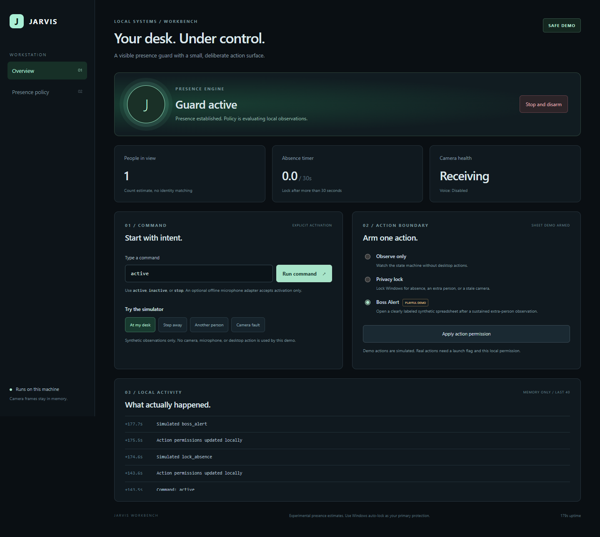

# Jarvis Workbench

A local workstation assistant with hand gestures, a presence guard, and optional AI chat. Setup recommends a starting point from three choices: what you do, your monthly budget, and the tools you already have.

[Guided setup and gesture practice](https://jarvis-workbench.jrgoldin.chatgpt.site) / [Releases and downloads](https://github.com/Jgolding1998/jarvis-workbench/releases/latest) / [Install with your AI agent](docs/INSTALL_WITH_AGENT.md)



## Get started

**Windows x64:** download **Jarvis-Windows.zip** and its checksum from the same release, verify SHA-256, and extract the folder. Double-click **Start-Jarvis-Windows.cmd**. Python, the device packages, and the hand model are included. No administrator account is needed.

Choose your role, monthly budget, and existing tool from the three dropdowns. Review the recommendation, then choose **Install selected tools**. In the portable edition this checks the included dependencies. The source edition installs them into the project's `.venv`. **Open dashboard** starts the selected Windows feature idle, with real actions disarmed.

AI chat is optional. If you choose a cloud provider, create your own API key on its official website and enter it in the local app. It is kept in Windows Credential Manager. The public website never asks for a key. Testing a connection sends one short request only after you confirm it and may use your provider credits.

**From source:** install [Python 3.11 or newer](https://www.python.org/downloads/), extract **Get-Jarvis-Workbench.zip**, and run **Start-Jarvis.cmd** on Windows. On macOS or Linux, open a terminal in the source folder and run:

```
python3 -m jarvis.launcher
```

The launcher opens setup in safe simulation mode. Saving choices, installing dependencies, and adding an API key do not open a camera or microphone, move the cursor, or arm Windows actions. Other operating systems can use the browser simulator; the beginner desktop installation targets Windows x64.

A phone can use the guide and virtual gesture practice, then save the choices for a computer. This ZIP cannot install an iPhone or Android app. The phone website cannot operate a computer's camera, mouse, or lock screen.

## Add optional tools on Windows

Double-click **Install-Optional-Tools.cmd**, choose a menu item, and confirm the downloads:

1. **Camera** for the presence guard.
2. **Camera + hand gestures** for `watch me`. This also downloads and verifies the official hand model.
3. **Offline voice** for local recognition. A Vosk voice model is a separate manual download.
4. **All optional tools** for all three.

This menu is for source installations. It uses the project's `.venv` folder and leaves devices off. Then reopen **Start-Jarvis.cmd**, which uses that environment automatically. The portable download already contains these packages; do not run pip inside its embedded Python. On macOS or Linux, use `python3 -m jarvis.install_tools` for the source menu.

For the voice model and live launch examples, follow the [setup guide](docs/BUILD_YOUR_OWN.md).

## What works today

| Feature | Status | Needs | Cost |
| --- | --- | --- | --- |
| Local dashboard and typed commands | Implemented | Python | $0 |
| Safe simulator | Implemented | Python | $0 |
| Presence guard (people count) | Implemented | Camera, OpenCV | $0 |
| Privacy lock | Implemented | Windows, camera | $0 |
| Boss Alert synthetic workbook (playful demo) | Implemented | Windows, camera, spreadsheet app | $0 |
| Offline voice activation (Vosk) | Implemented | Windows, microphone, voice packages, a downloaded model | $0 |
| Hand control practice (virtual cursor, clap to stop) | Implemented | Python | $0 |
| Local hand tracking with optional real cursor | Implemented, experimental | Windows, camera, hand packages and model | $0 |
| AI text chat: NVIDIA, OpenAI, Anthropic, Ollama | Implemented, optional | Your own cloud API key or local Ollama model | Set by the provider or your hardware |
| ElevenLabs or your computer's built-in voice tools | Guidance only, no connector | Your own account or system settings | Set by the provider |

The recommendation is deterministic: the same choices give the same plan. AI replies are text only. They cannot run commands, inspect files, change permissions, or operate the desktop.

## Planning costs

The app has its own dashboard. It does not include the movie character's voice, startup music, a weather service, or an always-listening "Jarvis" wake word. Offline voice is a separate setup for the specific commands described below; downloading the app does not turn on a microphone.

The local dashboard, presence guard, hand control, and offline voice have no subscription charge. At a $0 budget, setup suggests NVIDIA's no-cost evaluation access or an existing local Ollama installation. NVIDIA availability and limits depend on your account and the model; rate limits and busy periods can cause waiting. Local models use your hardware, memory, electricity, and disk space. Free does not always mean slower.

Cloud APIs can charge for requests. The monthly dropdown is a planning preference, not an enforced billing limit. Set limits with the provider. Some chat subscriptions offer eligible API credits or other benefits; check your account rather than assuming a subscription includes API access. Jarvis does not purchase credits, create keys, or promise a fixed monthly bill.

## Use the dashboard

After setup, start the safe demo at any time:

```
python -m jarvis.server --demo
```

Open **http://127.0.0.1:8765**. The demo simulates desktop actions and does not create files.

1. Type `active` and choose **Run command**.
2. Choose **Privacy lock** and apply the permission.
3. Choose **Step away**. After more than 30 seconds, the activity list records a simulated lock.
4. Choose **At my desk** to reset the absence timer.
5. Choose **Another person**. After two continuous seconds, the privacy action is simulated.
6. Use **Stop and disarm** to stop evaluation and clear both action permissions.

For **Boss Alert**, select that action instead of privacy lock. Two people in view for two seconds produces a simulated workbook event. This is a playful synthetic-data demonstration, not identification of a boss or an attempt to hide activity.

### Hand control

The **Hand control** panel has a practice pad. Start practice, move inside the pad to steer a virtual cursor, try left and right pinch, and use **Clap to stop**. Practice never moves the real cursor or opens the camera.

Typed `watch me` or `watchme` starts the local MediaPipe hand camera; `stop mouse` stops it. Follow the [hand control guide](docs/HAND_CONTROL.md) to install the optional packages and verified model, then launch with `--allow-hand-control`. Real pointer movement stays off until you enable its separate dashboard permission and start a hand session. Voice `watch me` also needs offline voice and its own dashboard opt-in.

Clap, Esc, `stop mouse`, or **Stop hand control** stops hand control only. Hand stop never disarms presence permissions; an active presence guard keeps running during hand practice. The camera has one owner at a time: hand control and the presence guard cannot both use it, and starting one while the other runs gives a clear message instead of silently stopping either.

## Build your own

The [setup guide](docs/BUILD_YOUR_OWN.md) covers a fresh environment, local voice models, observation-only camera calibration, and the separate flags that permit real actions. The [architecture](docs/ARCHITECTURE.md) explains state transitions and the security boundary.

## Test

```
python -m unittest discover -s tests -v
```

The suite covers the presence policy timing, invalid inputs, workbook contents, simulated action isolation, local session authorization, DNS rebinding, and cross-origin requests. It also covers the setup wizard: answer validation, prototype-key and unknown-field rejection, budget limits, deterministic plans, identical results from the Python and browser planners (when Node.js is installed), atomic config saving, the local HTTP routes, the launcher's end-to-end apply and exit, the missing-Python message, hand control permissions, camera ownership, clap and Esc stops, and fake cursor output. Tests use fake observations and fake Windows calls; they never open a camera or microphone, move the cursor, or lock the machine.

Camera accuracy, microphone recognition, a physical Windows lock, opening Excel, and live hand tracking need manual checks on your own hardware. A successful Windows API result means the request started, not proof that it completed.

## Limits worth understanding

OpenCV's bundled HOG detector expects visible people, usually with substantial body framing. A seated head-and-shoulders webcam view can be missed. Establish a reliable single-person observation before trusting the timer. This edition does not recognize individuals.

This is an experimental supplementary guard. Keep Windows auto-lock enabled. It does not unlock Windows, replace authentication, certify camera reliability, or run unattended at startup.

If the camera cannot open or its reader fails, restart the process after resolving the device problem. An armed guard treats a first frame delayed more than five seconds as a camera fault and requests a lock.

## References

The implementation uses documented interfaces from [OpenCV](https://docs.opencv.org/4.x/d5/d33/structcv_1_1HOGDescriptor.html), [Vosk](https://alphacephei.com/vosk/install), and Microsoft's [LockWorkStation](https://learn.microsoft.com/en-us/windows/win32/api/winuser/nf-winuser-lockworkstation) and [GetAsyncKeyState](https://learn.microsoft.com/en-us/windows/win32/api/winuser/nf-winuser-getasynckeystate) APIs. The Windows package includes third-party dependencies and the official hand model with their license notices. No account credentials are included. This project's own code uses the [MIT License](LICENSE).

## Feedback

[Suggest an improvement or report a problem](https://github.com/Jgolding1998/Jgolding1998/issues/new?template=feedback.yml). The board is public. Use synthetic examples and leave out keys, personal information, and private documents. Follow [SECURITY.md](SECURITY.md) for security reports.
