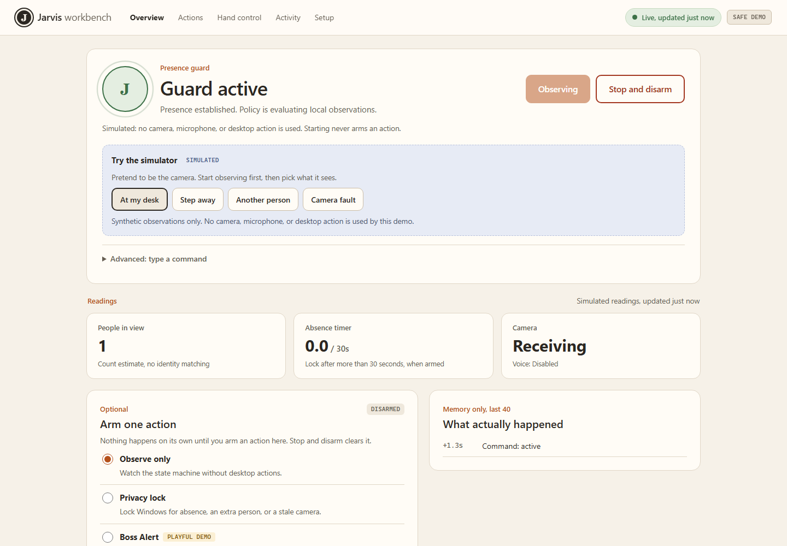

# Jarvis Workbench

A local workstation assistant with hand gestures, a presence guard, and optional AI chat. Setup asks one question at a time about your purpose, budget and tools, then gives you one starting configuration.

[Guided setup and gesture practice](https://jarvis-workbench.jrgoldin.chatgpt.site) / [Releases and downloads](https://github.com/Jgolding1998/jarvis-workbench/releases/latest) / [Install with your AI agent](docs/INSTALL_WITH_AGENT.md)



## Get started

**Windows x64:** download **Jarvis-Windows.zip** and its checksum from the same release, verify SHA-256, and extract the folder. Double-click **Start-Jarvis-Windows.cmd**. Python, the device packages, and the hand model are included. No administrator account is needed.

Choose your purpose, monthly AI allowance, existing AI, typing or voice tools, reply preference and optional future automation. Use **Next** between questions. Review the recommendation. A complete portable edition already includes the selected tools, so it skips the install step and goes straight to **Open dashboard**. The source edition (or an incomplete package) shows **Install selected tools**, which installs into the project's `.venv` only after you choose it. **Open dashboard** starts the selected Windows feature idle, with real actions disarmed.

AI chat is optional. If you choose a cloud provider, create your own API key on its official website and enter it in the local app. It is kept in Windows Credential Manager. The public website never asks for a key. Testing a connection sends one short request only after you confirm it and may use your provider credits.

**From source:** install [Python 3.11 or newer](https://www.python.org/downloads/), extract **Get-Jarvis-Workbench.zip**, and run **Start-Jarvis.cmd** on Windows. On macOS or Linux, open a terminal in the source folder and run:

```
python3 -m jarvis.launcher
```

The launcher opens setup in safe simulation mode. Saving choices, installing dependencies, and adding an API key do not open a camera or microphone, move the cursor, or arm Windows actions. Other operating systems can use the browser simulator; the beginner desktop installation targets Windows x64.

The desktop app opened from setup stops when you choose Exit Jarvis in setup, press Ctrl+C in setup's terminal, or close that terminal. The same applies to **Install selected tools**: exiting setup stops the running install step and everything it started, keeps existing files, and leaves setup reporting the tools as not installed, so choose Install again next time. On Windows each install step runs in a kill-on-close job, so it also stops if setup is ended from Task Manager. The source install menu uses the same runner. Exit Jarvis on the desktop dashboard stops that app while leaving setup available. Closing a browser tab leaves the local service running; use Exit Jarvis to stop it. To change setup, use the setup window; the desktop app does not include the setup wizard.

A phone can use the guide and virtual gesture practice, then save the choices for a computer. This ZIP cannot install an iPhone or Android app. The phone website cannot operate a computer's camera, mouse, or lock screen.

## Add optional tools on Windows

Double-click **Install-Optional-Tools.cmd**, choose a menu item, and confirm the downloads:

1. **Camera** for the presence guard.
2. **Camera + hand gestures** for `watch me`. This also downloads and verifies the official hand model.
3. **Offline voice** for local recognition. A Vosk voice model is a separate manual download.
4. **All optional tools** for all three.

This menu is for source installations. It uses the project's `.venv` folder and leaves devices off. Then reopen **Start-Jarvis.cmd**, which uses that environment automatically. The portable download already contains these packages; do not run pip inside its embedded Python. On macOS or Linux, use `python3 -m jarvis.install_tools` for the source menu.

For the voice model and live launch examples, follow the [setup guide](docs/BUILD_YOUR_OWN.md).

## What works today

| Feature | Status | Needs | Cost |
| --- | --- | --- | --- |
| Local dashboard and typed commands | Implemented | Python | $0 |
| Safe simulator | Implemented | Python | $0 |
| Presence guard (people count) | Implemented | Camera, OpenCV | $0 |
| Privacy lock | Implemented | Windows, camera | $0 |
| Boss Alert synthetic workbook (playful demo) | Implemented | Windows, camera, spreadsheet app | $0 |
| Offline voice activation (Vosk) | Implemented | Windows, microphone, voice packages, a downloaded model | $0 |
| Hand control practice (virtual cursor, clap to stop) | Implemented | Python | $0 |
| Local hand tracking with optional real cursor | Implemented, experimental | Windows, camera, hand packages and model | $0 |
| AI text chat: NVIDIA, OpenAI, Anthropic, Ollama | Implemented, optional. OpenAI/Anthropic requests pause after 2026-11-27 (UTC) until pricing is reviewed again | Your own cloud API key or local Ollama model | Set by the provider or your hardware |
| Read AI replies aloud in local setup | Implemented, opt-in | A browser voice marked as on-device | $0 |
| Windows voice typing or existing Wispr Flow | External dictation into text boxes | Your own system settings or installed tool | Set by the tool |
| ElevenLabs, MCP, calendar and email integration | Not built in | Future integration | Not included |

The recommendation is deterministic: the same choices give the same plan. AI replies appear as text, with optional on-device read-aloud in local setup. They cannot run commands, inspect files, change permissions, or operate the desktop.

## Planning costs

The app has its own dashboard. It does not include the movie character's voice, startup music, a weather service, or an always-listening "Jarvis" wake word. Offline voice is a separate setup for the specific commands described below; downloading the app does not turn on a microphone.

The local dashboard, presence guard, hand control, and offline voice have no subscription charge. At a $0 budget, setup suggests NVIDIA's no-cost evaluation access or an existing local Ollama installation. NVIDIA availability and limits depend on your account and the model; rate limits and busy periods can cause waiting. Local models use your hardware, memory, electricity, and disk space. Free does not always mean slower.

The slider covers $0 to $1,000, with an exact amount up to $10,000. Before each OpenAI or Anthropic attempt, this installation reserves $0.01 from that month's allowance and refuses attempts when it is used up. The reservation stays after an error because the provider may still have processed the request. This is a conservative allowance, not a report of your actual bill. It persists across restarts and is shared by setup and the desktop app. At $0, paid requests stop before reading a key or contacting the provider. NVIDIA trial access and local Ollama do not consume this paid allowance.

Set a provider spend limit too. Jarvis cannot control other apps, verify NVIDIA trial eligibility, or guarantee a provider's final invoice. The fixed-model pricing check expires after November 27, 2026; paid requests then pause until the app's reviewed pricing is updated. [OpenAI's hard-limit option](https://help.openai.com/en/articles/9186755-managing-projects-in-the-api-platform) can stop tracked spending, with a possible small enforcement delay. [Anthropic's spend limits](https://platform.claude.com/docs/en/api/rate-limits) provide a separate account control. Some chat subscriptions offer eligible API credits; check your account. Jarvis never purchases credits or creates keys.

## Use the dashboard

After setup, start the safe demo at any time:

```
python -m jarvis.server --demo
```

Open **http://127.0.0.1:8765**. The demo simulates desktop actions and does not create files. Everything marked **SIMULATED** is synthetic.

1. Choose **Start observing**. This only observes: it never arms an action, opens a device you did not enable at launch, moves the cursor, or changes a permission.
2. Choose **Privacy lock** and apply the permission.
3. Choose **Step away**. After more than 30 seconds, the activity list records a simulated lock.
4. Choose **At my desk** to reset the absence timer.
5. Choose **Another person**. After two continuous seconds, the privacy action is simulated.
6. Use **Stop and disarm** to stop evaluation and clear both action permissions. The dashboard says "Stop confirmed by Jarvis" only after the service answers with a stopped, disarmed state.

Typed commands (`active`, `inactive`, `stop`, `watch me`, `stop mouse`) remain available under **Advanced: type a command**.

Until the first status arrives, the dashboard shows guard, actions and hand control as unknown and keeps Start, permissions and practice unavailable. The connection badge shows whether readings are live. If status updates stall or fail, the dashboard marks readings as delayed, then unknown, and shows the last known state with its age. A lost browser connection is never reported as a stopped or disarmed guard; Stop stays available and reports whether Jarvis confirmed it. A restarted service requires a reload. **Copy diagnostics** produces a short report of mode, operating system, Python version, optional package and model availability, and connection state, without keys, chat text, file paths, host names or camera data.

For **Boss Alert**, select that action instead of privacy lock. Two people in view for two seconds produces a simulated workbook event. This is a playful synthetic-data demonstration, not identification of a boss or an attempt to hide activity.

### Hand control

The **Hand control** panel has a practice pad. Start practice, move inside the pad to steer a virtual cursor, try left and right pinch, and use **Clap to stop**. Practice never moves the real cursor or opens the camera.

Typed `watch me` or `watchme` starts the local MediaPipe hand camera; `stop mouse` stops it. Follow the [hand control guide](docs/HAND_CONTROL.md) to install the optional packages and verified model, then launch with `--allow-hand-control`. Real pointer movement stays off until you enable its separate dashboard permission and start a hand session. Voice `watch me` also needs offline voice and its own dashboard opt-in.

Point with one raised open hand. Thumb to middle finger is a left click; thumb to ring finger is a right click. A second hand held clearly lower in the camera view is ignored, and it never takes over when the raised hand leaves. The tracker sees hands, not your body, so this is judged from the image; see the guide for the exact rule and framing limits.

Clap, Esc, `stop mouse`, or **Stop hand control** stops hand control only. Hand stop never disarms presence permissions; an active presence guard keeps running during hand practice. The camera has one owner at a time: hand control and the presence guard cannot both use it, and starting one while the other runs gives a clear message instead of silently stopping either.

## How it is built

- **Problem:** a desk companion that can watch for presence or hand gestures is only trustworthy if it is obvious what it is doing, what is simulated, and what happens when something fails.
- **Choices:** a standard-library Python service bound to loopback with a per-process token and strict Content Security Policy; a deterministic presence state machine; fixed command and action allowlists; devices off until separate launch flags and local arming; AI replies treated as plain text that cannot trigger actions. The dashboard, setup and public practice site are plain HTML, CSS and JavaScript with no framework, remote fonts or analytics.
- **Reproduce:** `python -m jarvis.server --demo`, then `python -m unittest discover -s tests -v`. Browser checks run with `node tests/browser_quickstart.cjs` (setup, website and dashboard, with a mocked API and a local Chromium).
- **Lessons applied:** [what we learned from related projects' public issues](docs/UPSTREAM_LESSONS.md), with their status at inspection time.
- **Limits:** see [Limits worth understanding](#limits-worth-understanding). Simulated tests and fixtures are not evidence of camera accuracy or of a completed Windows lock.
- **Collaboration:** developed with AI coding assistants (including OpenAI Codex and Anthropic Claude Code) working under the maintainer's direction. The commit history records the actual changes.

## Build your own

The [setup guide](docs/BUILD_YOUR_OWN.md) covers a fresh environment, local voice models, observation-only camera calibration, and the separate flags that permit real actions. The [architecture](docs/ARCHITECTURE.md) explains state transitions and the security boundary.

## Test

```
python -m unittest discover -s tests -v
```

The suite covers the presence policy timing, invalid inputs, workbook contents, simulated action isolation, local session authorization, DNS rebinding, and cross-origin requests. It also covers the setup wizard: answer validation, prototype-key and unknown-field rejection, budget limits, deterministic plans, identical results from the Python and browser planners (when Node.js is installed), atomic config saving, the local HTTP routes, the launcher's end-to-end apply and exit, the missing-Python message, hand control permissions, camera ownership, clap and Esc stops, fake cursor output, and microphone loss recovery with a fake audio stream. Browser fixtures also cover the dashboard: live, delayed and lost status, hung and failed polls, old snapshots, recovery, restart, truthful Stop acknowledgement, diagnostics, keyboard, phone layout and reduced motion. Tests use fake observations and fake Windows calls; they never open a camera or microphone, move the cursor, or lock the machine.

Camera accuracy, microphone recognition, a physical Windows lock, opening Excel, and live hand tracking need manual checks on your own hardware. A successful Windows API result means the request started, not proof that it completed.

Maintainers can run **Build Windows downloads** from the repository's Actions tab. It creates the source ZIP and portable Windows ZIP from the head of the selected branch or tag, checks pinned downloads and signatures, and runs the portable smoke tests on GitHub's Windows runner. The four ZIP and checksum files are retained as a build artifact for seven days. Checksums identify that run's files; ZIP bytes can differ across build hosts. Publishing a release is a separate step.

## Limits worth understanding

OpenCV's bundled HOG detector expects visible people, usually with substantial body framing. A seated head-and-shoulders webcam view can be missed. Establish a reliable single-person observation before trusting the timer. This edition does not recognize individuals.

This is an experimental supplementary guard. Keep Windows auto-lock enabled. It does not unlock Windows, replace authentication, certify camera reliability, or run unattended at startup.

If the camera cannot open or its reader fails, restart the process after resolving the device problem. An armed guard treats a first frame delayed more than five seconds as a camera fault and requests a lock.

## References

Interface refinement used [Unslop](https://github.com/heydamir/unslop) by Damir
Sokolovsky, licensed under CC BY 4.0, while retaining Jarvis's own interaction
and safety design.

The implementation uses documented interfaces from [OpenCV](https://docs.opencv.org/4.x/d5/d33/structcv_1_1HOGDescriptor.html), [Vosk](https://alphacephei.com/vosk/install), and Microsoft's [LockWorkStation](https://learn.microsoft.com/en-us/windows/win32/api/winuser/nf-winuser-lockworkstation) and [GetAsyncKeyState](https://learn.microsoft.com/en-us/windows/win32/api/winuser/nf-winuser-getasynckeystate) APIs. The Windows package includes third-party dependencies and the official hand model with their license notices. No account credentials are included. This project's own code uses the [MIT License](LICENSE).

## Feedback

[Suggest an improvement or report a problem](https://github.com/Jgolding1998/Jgolding1998/issues/new?template=feedback.yml). The board is public. Use synthetic examples and leave out keys, personal information, and private documents. Follow [SECURITY.md](SECURITY.md) for security reports.
